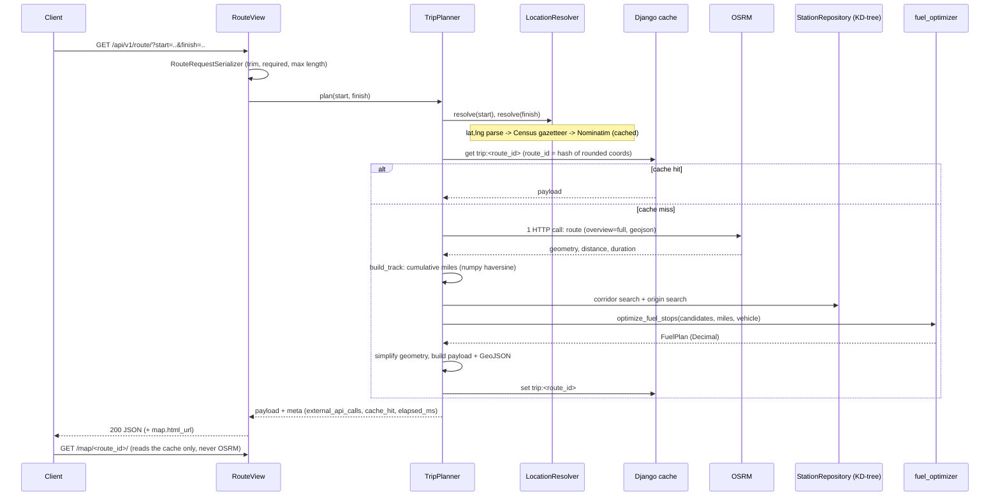

# Architecture

## Layers

| Layer | Location | Responsibility | Depends on |
|---|---|---|---|
| Domain | `apps/routing/domain/` | Frozen dataclasses (`GeoPoint`, `Station`, `Route`, `FuelPlan`, ...) and domain exceptions. No Django, no HTTP. | nothing |
| Services | `apps/routing/services/` | Business logic: geocoding, OSRM client, geometry, corridor search, fuel optimizer, presenter, and the `TripPlanner` orchestrator. | domain, numpy/scipy, `requests` |
| API | `apps/routing/api/` | DRF serializer, thin views, the single exception handler. | services |
| Web | `apps/routing/web/` + `templates/` | Leaflet map page rendered from the cache. | services |
| Stations | `apps/stations/` | `Station` model, Census gazetteer, CSV import pipeline, in-memory `StationRepository` with the KD-tree. | domain, geometry helpers |

The composition root is `apps/routing/services/container.py`. It reads settings and wires
the collaborators once per process, so views never construct services themselves and tests
can swap any piece (`TripPlanner` receives its geocoder, router, repository and cache).

## Request flow

## Why each piece exists

- **Offline gazetteer** (`data/us_places_gazetteer.txt`): the CSV has no coordinates and user
  input is usually "City, ST". Resolving both from a local Census file keeps the normal
  request at exactly one external call (OSRM) and the import fully reproducible.
- **Geocode cache file** (`data/geocode_cache.json`): the ~225 places the gazetteer misses
  (townships, unincorporated communities) were resolved once through Nominatim and committed,
  so re-running the import never touches the network.
- **`StationRepository`**: stations are loaded into immutable objects and a `cKDTree` over 3D
  unit vectors once per process (about 35 ms), guarded by a lock. Requests never query the
  database for stations.
- **Two stage corridor search** (`corridor.py`): the station tree answers "which stations are
  near a coarse sample of the route" (a guaranteed superset), then a per-request tree over the
  full route gives each candidate its exact nearest vertex and mile marker.
- **Pure optimizer** (`fuel_optimizer.py`): zero Django imports; easy to reason about and
  covered 100 percent by unit tests.
- **Presenter** (`trip_presenter.py`): the only place that rounds numbers and shapes JSON,
  so the cached payload, the API response and the map page all agree.
- **One exception handler**: every domain exception carries a stable `code` and is mapped to
  its HTTP status in `api/exception_handler.py`.
- **Shared `requests.Session`**: pooled connections, a real User-Agent, explicit timeouts, and
  retries on connection errors only (never on read timeouts, so a slow provider cannot
  multiply external calls).
